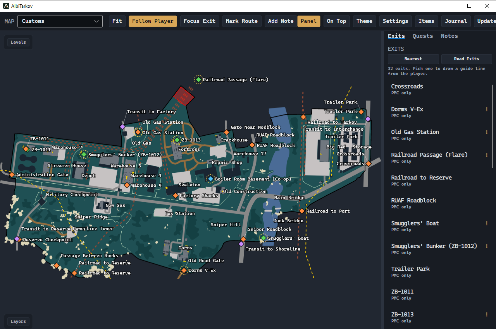

# AlbiTarkov

Mapa Tarkova na drugi monitor. Jesteś na Customs, masz w plecaku coś wartego wyniesienia, a Twoje wyjście wymaga prądu. Klikasz ZB-1013 i widzisz na mapie zarówno bunkier, jak i przełącznik w magazynie.

## Pobierz na Windows

[Pobierz instalator AlbiTarkov na Windows 10 lub 11, 64-bit](https://github.com/Albidev1/AlbiTarkov/releases/latest/download/AlbiTarkov-win-Setup.exe)

Uruchom pobrany plik i przenieś okno mapy na drugi monitor. Instalator zawiera środowisko .NET, mapy i katalog przedmiotów. Pierwsze wydanie nie ma podpisu wydawcy Windows.

## W rajdzie

- **Gdzie jestem?** Naciśnij w Tarkovie klawisz zrzutu ekranu. Gdy gra zapisze plik, na mapie pojawią się Twoja pozycja i kierunek patrzenia. Kolejny zrzut przesuwa znacznik. Nazwy budynków włączysz w *Layers → Building and area names*.
- **Czy to zabrać?** Najedź na przedmiot, poczekaj na angielską nazwę i naciśnij Shift + lewy przycisk myszy. Na drugim monitorze zobaczysz ikonę, zadania wymagające tego przedmiotu i ceny skupu u handlarzy. Esmarch przyda się do „First in Line”, jeśli ma oznaczenie *Found in Raid*.
- **Którędy wyjść?** Wybierz wyjście z listy albo kliknij jego znacznik. Przy wyjściach z potwierdzoną lokalizacją przełącznika zobaczysz także miejsce aktywacji. Wiersze oznaczone *Transit* prowadzą do kolejnego rajdu.
- **Co mogę zrobić po drodze?** W *Journal → On this map* znajdziesz cele aktywnych zadań z przypisanymi współrzędnymi. Aplikacja odtwarza przyjęte i ukończone zadania ze zdarzeń w zachowanych logach. Brakujące starsze logi mogą oznaczać niepełną listę.

## Dane na Twoim komputerze

AlbiTarkov czyta zrzuty i logi zapisane przez grę. Przy Shift + klik odczytuje tekst z niewielkiego fragmentu ekranu wokół kursora. Rozpoznawanie działa lokalnie. Ustawienia, historia i lista celów trafiają do folderu AlbiTarkovData w lokalnych danych użytkownika Windows.

## Aktualizacje

Po uruchomieniu program sprawdza publiczne wydania na GitHubie. Gdy pojawi się nowa wersja, zobaczysz *Update available*. Możesz też wybrać *Updates*. Pobranie i restart uruchamiasz samodzielnie, choćby po powrocie do skrytki.

AlbiTarkov jest nieoficjalną aplikacją opartą na [Tarkov Map Companion](https://github.com/Battleroid/tarkov-map-companion). Autorzy map i źródła danych są wymienieni w [informacjach o licencjach](NOTICE.md).
